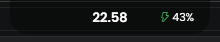
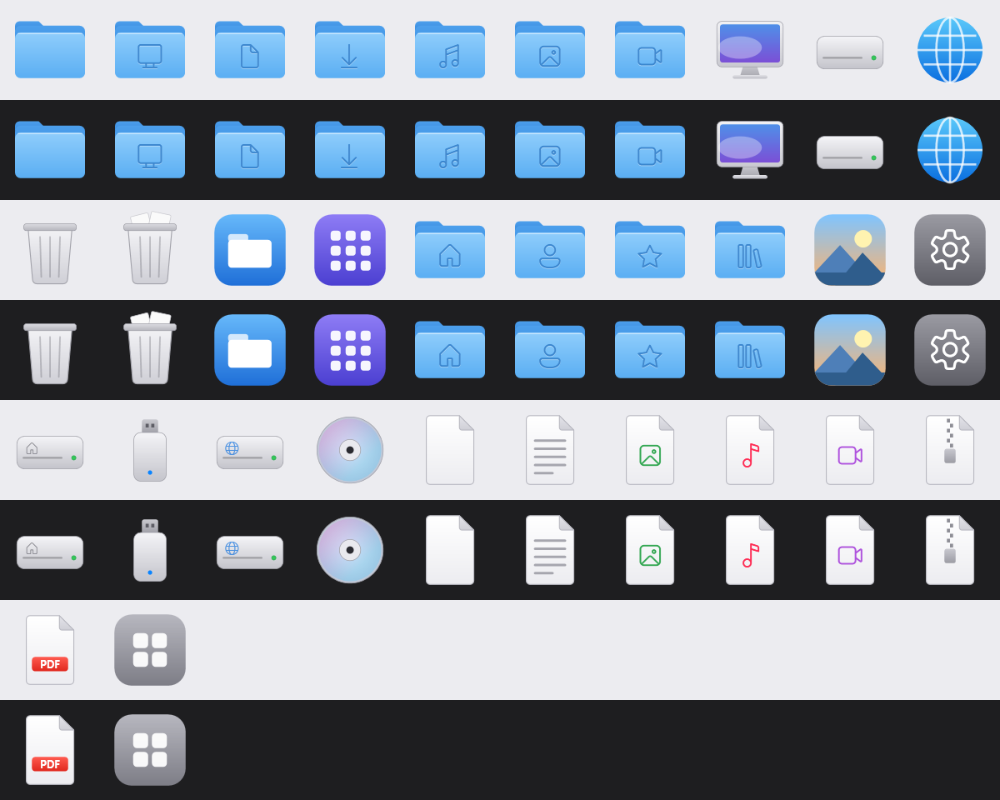

# MyNotch

**A macOS-style notch, dock and icon set for Windows — in one native app.**

Most "Dynamic Island for Windows" projects add an overlay on top of the taskbar. MyNotch replaces it:
a notch at the top for media and quick settings, a magnifying dock at the bottom, and a matching
system icon theme for Explorer. Native WPF / .NET 10, no Electron, ~0 setup.




## Features

**Notch**
- Clock, now-playing title and battery % (green bolt while the charger is plugged in)
- Hover to expand: album art + play/pause/skip for any app using Windows media controls (Spotify, browsers, …)
- Wi-Fi: pick a network and connect, including password prompt
- Bluetooth: paired devices, one-click connect/disconnect
- Volume, screen brightness (laptop panels), system-wide dark mode, Windows accent color
- Styles: solid, transparent or blurred glass; floating or attached to the screen edge

**Dock (taskbar replacement)**
- Registered as an AppBar, so maximized windows never cover it
- Your taskbar pins, plus running apps grouped per executable (no duplicates)
- Gaussian magnification on hover, active/open indicators, clock and date
- Hides automatically when a fullscreen game or video is running

**Icons**
- 30+ macOS-style system icons (folders, drives, This PC, Recycle Bin, file types), drawn in code —
  no Apple assets. Applied to Explorer with one toggle (admin prompt), fully reversible.



## Install

1. Download `MyNotch.exe` from [Releases](../../releases) (self-contained, no .NET install needed).
2. Run it. The Windows taskbar is auto-hidden while MyNotch runs and restored when you quit.

Requires Windows 10 version 2004 (build 19041) or later, x64.

## Quit / restore

Use the power button in the expanded notch, or right-click the dock → **Quit and restore taskbar**. If MyNotch was force-killed
and your taskbar stays hidden, run:

```
MyNotch.exe --restore
```

## Build from source

```
dotnet build
dotnet publish -c Release -r win-x64 --self-contained true -p:PublishSingleFile=true -p:EnableCompressionInSingleFile=true
```

Other command-line options: `--selftest` (logic checks, exit code 0 = pass), `--accent RRGGBB`,
`--window-accent on|off`, `--export-icons <dir>`.

## Development notes

[`CHANGELOG_FIXES.md`](CHANGELOG_FIXES.md) records every non-trivial bug: symptom, root cause, fix and how it was verified.

## License

MIT. Bundled Poppins font: SIL Open Font License ([Fonts/OFL.txt](Fonts/OFL.txt)).
Not affiliated with Apple or Microsoft.
